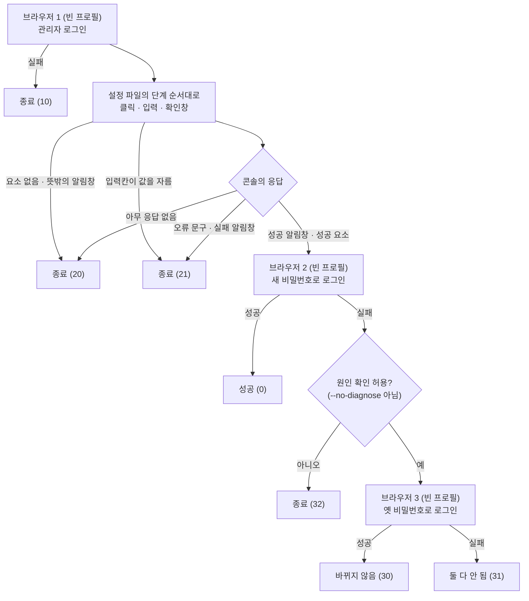

# web-password-rotate

웹 관리 콘솔에서 계정 비밀번호를 바꾸고, **새 비밀번호로 실제 로그인이 되는지까지 확인**하는 Selenium 도구입니다.

브라우저 화면으로만 비밀번호를 바꿀 수 있는 장비가 있습니다. 실습에서 이런 장비의 비밀번호를 자동으로 바꾸는 스크립트를 만들었습니다. 이 레포는 그 스크립트를 같은 구조로 **처음부터 다시 쓴** 공개 버전입니다. 원래 스크립트는 한 콘솔 화면에 맞춰 짜여 있었습니다. 여기서는 화면마다 달라지는 부분(선택자, 프레임, 클릭 순서)을 TOML 설정 파일로 모두 뺐습니다.

```text
14:44:28 start: account svc_app on http://127.0.0.1:54002
14:44:30 admin sign-in: ok (landed on http://127.0.0.1:54002/admin/console)
14:44:30 step 1/7 click css:#nav-users in frame nav: ok
14:44:30 step 2/7 click xpath://div[contains(@class,'cell') and ...]//div[contains(@class,'row-checker')] in frame main: ok
  ...
14:44:31 step 7/7 accept alert containing 'change the password': ok
14:44:31 result: alert 'Password updated'
14:44:33 verify: new browser, empty profile
14:44:36 verify: new password refused (Sign-in failed)
FAIL 30: password was not changed: the old password still signs in
```

위 로그는 테스트용 가짜 콘솔에 "저장했다고 표시만 하고 실제로는 저장하지 않는" 고장을 켜고 돌린 결과입니다. 화면에는 `Password updated`가 떴습니다. 그래도 검증 단계에서 새 비밀번호로 로그인이 안 되고 옛 비밀번호로는 되는 것을 확인해, "바뀌지 않음"(30)으로 판정했습니다. 선택자는 일부 줄였습니다.

## 흐름



## 구성

| 파일 | 하는 일 |
|---|---|
| `config.py` | TOML을 읽고 검사함. 선택자와 단계를 데이터로 만들고 `{account}` 같은 자리표시자를 채움 |
| `browser.py` | 빈 프로필로 브라우저 기동, 프레임 진입, 기다리기, 클릭, 입력, 알림창 처리 |
| `flow.py` | 관리자 로그인 → 변경 단계 → 결과 판정 → 새 브라우저로 검증 → 실패 원인 구분 |
| `cli.py` | 인자와 환경변수 처리. 진행 로그는 stderr, 결과 한 줄은 stdout, 원인은 종료코드 |
| `examples/demo-console.toml` | 테스트용 가짜 콘솔에 맞춘 설정. 다른 콘솔에 쓸 때 복사해서 고치는 기준 |
| `tests/fake_console.py` | 테스트용 가짜 관리 콘솔과 사용자 포털. 고장 스위치로 실패 상황을 재현 |

종료코드:

| 코드 | 뜻 |
|---|---|
| `0` | 바꿨고, 새 비밀번호로 로그인까지 됨 |
| `2` | 설정이나 인자 오류 (브라우저를 띄우기 전에 멈춤) |
| `10` | 관리자 로그인 실패 |
| `20` | 화면 문제: 요소를 못 찾음, 뜻밖의 알림창, 저장 뒤 아무 응답 없음 |
| `21` | 콘솔이 값을 거부함: 정책 위반 문구, 실패 알림창, 입력칸 길이 제한 |
| `30` | 바뀌지 않음: 옛 비밀번호로 아직 로그인됨 |
| `31` | 새 비밀번호도 옛 비밀번호도 로그인 안 됨 (계정 잠김, 비활성화 등) |
| `32` | 새 비밀번호로 로그인 안 됨. 옛 비밀번호는 일부러 시도하지 않음 |
| `40` | 브라우저가 뜨지 않음 |
| `41` | 전체 제한시간 초과 |

30, 31, 32는 바뀐 비밀번호가 무엇인지 알려주는 신호이기도 합니다. 30이면 지금 비밀번호는 옛것입니다. 31이면 어느 쪽인지 사람이 확인해야 합니다. 그래서 30과 31을 한 코드로 합치지 않았습니다.

## 설계 판단

**검증은 새 브라우저로 합니다.** 변경에 쓴 브라우저에는 관리자 세션 쿠키가 남아 있습니다. 포털이 세션을 같이 쓰면 로그인 화면을 건너뛰고 바로 들어가 버립니다. 그러면 비밀번호가 무엇이든 검증이 통과합니다. 그래서 빈 프로필로 브라우저를 새로 띄우고, 끝나면 프로필 폴더를 지웁니다. 테스트 `test_reusing_the_admin_browser_would_fake_a_success`가 이 상황을 재현합니다.

**화면에 "저장됨"이 떠도 믿지 않습니다.** 성공은 새 비밀번호로 로그인이 됐을 때만입니다. 새 비밀번호로 안 되면 옛 비밀번호로 한 번 더 시도해서 "저장이 안 됨"(30)과 "저장은 됐는데 로그인 불가"(31)를 구분합니다. 다만 몇 번 틀리면 계정을 잠그는 곳에서는 이 시도가 실패 횟수를 하나 더 씁니다. 그런 곳에서는 `--no-diagnose`로 끄면 됩니다.

**아무 응답이 없으면 실패입니다.** 마지막 단계 뒤에 성공 알림창도 성공 요소도 나오지 않으면 20으로 끝냅니다. 설정 파일에 성공 신호를 하나도 적지 않으면 아예 시작하지 않습니다.

**프레임은 매번 맨 위 문서에서 다시 들어갑니다.** 요소 찾기는 지금 들어가 있는 문서 안에서만 됩니다. 한 프레임 안에서 옆 프레임으로 바로 갈 수도 없습니다. 실습에서 로그인은 되는데 화면 요소를 하나도 못 찾았던 원인이 이것이었습니다. 그래서 찾을 때마다 맨 위로 나갔다가 프레임 경로(`main/inner`)를 따라 내려갑니다.

**표준 HTML이 아닐 수 있다고 가정합니다.** JavaScript 프레임워크로 그린 화면은 체크박스가 `<div>`이고 버튼이 `<span>`인 경우가 있습니다. 실습 콘솔이 그랬습니다. 선택자는 목록으로 여러 개를 적을 수 있고, 위에서부터 보이는 요소를 먼저 씁니다. 가려진 버튼은 JavaScript 클릭으로 한 번 더 시도합니다. 페이지에 어떤 요소와 선택자가 있는지는 [web-page-inspector](https://github.com/Shinbaee/web-page-inspector)로 확인합니다.

**알림창을 브라우저가 닫지 않게 합니다.** Selenium은 기본 설정에서 알림창이 뜨면 닫아 버리고 오류만 냅니다. 저장 결과를 알림창으로만 알려주는 콘솔이 많아서, 기본값 그대로면 결과 문구를 잃습니다. 공개판에서는 알림창을 그대로 두게 설정하고 직접 읽고 닫습니다. 확인창("변경하시겠습니까?")은 `accept_alert` 단계로 적습니다.

**입력칸이 비밀번호를 자르지 않는지 봅니다.** 입력칸에 `maxlength`가 있으면 브라우저는 넘치는 글자를 조용히 버립니다. 그러면 콘솔은 잘린 비밀번호를 저장합니다. 입력하기 전에 길이 제한을 보고, 입력한 뒤에는 칸에 들어간 글자 **수**만 다시 읽어 비교합니다. 값 자체는 읽지 않습니다. 이 검사는 공개판에서 새로 넣었습니다.

**백그라운드 스로틀링을 끕니다.** Chrome은 아무도 보지 않는 창이라고 판단하면 JavaScript 타이머와 화면 그리기를 늦춥니다. 실습에서는 원격 화면 뷰어를 연결하면 성공하고 끊으면 시간 초과가 났습니다. 스로틀링을 끄는 옵션을 넣고 나서 뷰어 없이도 성공했습니다.

**비밀번호는 정해진 자리에만 들어갑니다.** `{new}`, `{old}`는 입력 단계의 `value`에만 쓸 수 있습니다. 선택자나 URL에 넣으면 설정 검사에서 거부합니다. 선택자와 URL은 로그와 오류 메시지에 그대로 찍히기 때문입니다. 비밀번호는 환경변수로만 받습니다(명령 인자는 `ps`로 보입니다). 출력하기 전에 한 번 더 지웁니다. 테스트는 모든 경우에 출력에 비밀번호가 없는지 확인합니다.

**계정 이름은 선택자 안에서 문자열로만 쓰입니다.** `{account}`는 따옴표로 감싼 문자열로 바뀝니다. XPath에는 이스케이프 문자가 없어서, 따옴표가 섞인 이름은 `concat()`으로 만듭니다. 그래서 계정 이름에 `'] | //*[...`가 들어 있어도 선택자 구조가 바뀌지 않습니다.

**자동으로 되돌리지 않습니다.** 31처럼 상태가 불확실할 때 옛 비밀번호로 되돌리려 하면 상태가 더 꼬일 수 있습니다. 결과를 종료코드로 정확히 알리고, 판단은 호출한 쪽(비밀번호 관리 시스템이나 사람)에 맡깁니다.

**스크린샷은 켰을 때만 남깁니다.** 실패한 화면에는 계정 목록이나 내부 주소가 보일 수 있습니다. `--screenshot-dir`을 줬을 때만 저장하고, Linux에서는 본인만 읽을 수 있게(0600) 만듭니다.

## 쓰는 법

```bash
pip install .
```

1. `examples/demo-console.toml`을 복사해 대상 콘솔에 맞게 고칩니다
2. 설정을 검사합니다. 브라우저는 뜨지 않습니다:

```bash
web-password-rotate --config my-console.toml --account svc_app --admin-user admin --admin-password-env ADMIN_PW --new-password-env NEW_PW --check-config
```

3. 화면을 보면서 한 번 돌려봅니다 (`--show`):

```bash
web-password-rotate --config my-console.toml --account svc_app --admin-user admin --admin-password-env ADMIN_PW --new-password-env NEW_PW --old-password-env OLD_PW --show
```

설정 파일 형식은 `examples/demo-console.toml`에 주석으로 설명해 두었습니다. 단계는 `open`(주소 이동), `click`, `type`(+`value`), `accept_alert` 네 가지입니다.

## 테스트

```bash
pip install -e ".[test]"
pytest -v
```

`tests/fake_console.py`가 테스트 안에서 가짜 관리 콘솔과 사용자 포털을 띄웁니다. 두 프레임으로 된 화면, 늦게 그려지는 JavaScript 표, `<div>` 체크박스, 확인창, 성공 알림창, 세션을 같이 쓰는 포털이 들어 있습니다. 직접 보고 싶으면 `python tests/fake_console.py`로 띄워 브라우저로 열면 됩니다.

| 경우 | 기대 |
|---|---|
| 정상 | `0`, 선택한 계정만 바뀌고 검증 로그인은 한 번 |
| 표가 2.5초 늦게 그려짐 | 기다렸다가 `0` |
| 관리자 비밀번호 틀림 | `10`, 아무것도 안 바뀜 |
| 정책 위반 (너무 짧음) | `21`, 콘솔 문구를 그대로 보고 |
| 입력칸보다 긴 비밀번호 | `21`, 잘린 값도 저장되지 않음 |
| 목록에 없는 계정 | `20`, 몇 번째 단계인지 알려줌 |
| **"저장됨"이라고 뜨지만 저장 안 됨** | `30` |
| 같은 경우 + `--no-diagnose` | `32`, 로그인 실패는 한 번만 |
| 저장됐지만 계정이 로그인 불가 | `31` |
| 전체 제한시간 초과 | `41` |
| 변경에 쓴 브라우저를 검증에 다시 쓰면 | 로그인 화면 없이 통과돼 버림 (그래서 새 브라우저를 씀) |
| 설정 검사 | 비밀번호 자리표시자 위치, 모르는 키, 성공 신호 없음, 따옴표 섞인 계정 이름 |
| 모든 경우 | 출력에 비밀번호가 없음 |

CI(GitHub Actions)는 Ubuntu와 Windows에서 헤드리스 Chrome으로 전체 테스트를 돌립니다.

## 원래 스크립트와 다른 점

- Python 2.7 + Selenium 3 → Python 3.11+ + Selenium 4 (드라이버는 Selenium Manager가 찾음)
- 한 콘솔에 맞춘 코드 → 설정 파일로 다른 콘솔에도 쓸 수 있게 함
- 원래는 결과를 성공/실패 문자열 한 줄로 알렸음 → 원인별 종료코드
- 새로 넣은 것: 입력칸 길이 검사, 알림창 유지 설정, 비밀번호 자리표시자 위치 검사, 계정 이름 따옴표 처리, 전체 제한시간을 모든 대기에 적용
- 실습 환경의 주소, 계정, 화면 선택자는 들어 있지 않습니다

## 만든 방식

실습에서 직접 겪은 문제(프레임 안 요소, `<div>` 체크박스, 스로틀링)와 원래 스크립트의 설계(빈 프로필로 다시 로그인해 검증, 옛 비밀번호로 실패 원인 구분)를 바탕으로 구조를 잡았고, 코드는 Claude Code로 작성했습니다. 가짜 콘솔의 고장 상황(저장된 척하기, 세션 공유 포털)은 그 설계가 막으려던 경우를 테스트로 재현하려고 만든 것입니다.
